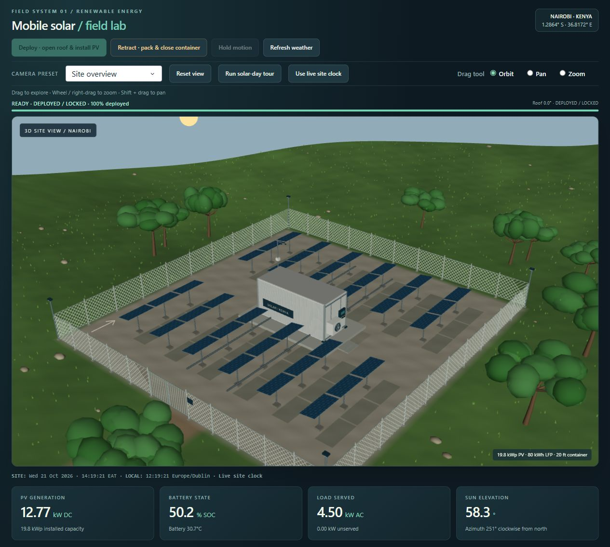
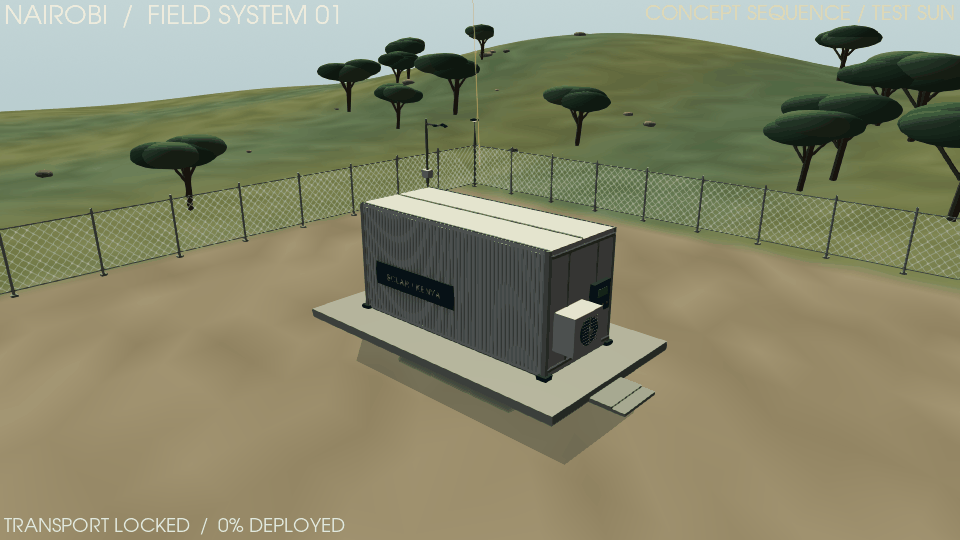
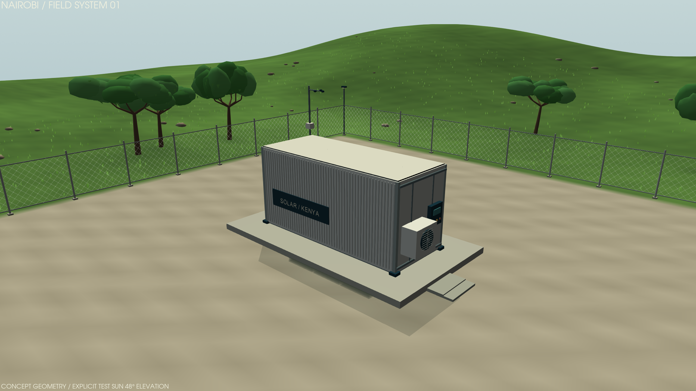
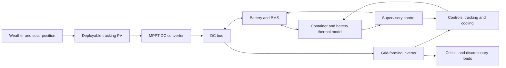

# Kenya mobile solar lab

A Python-only interactive dashboard and detailed energy/thermal/control model for deployable, container-based PV in Kenya. Nairobi is the default site. The main workspace shows a detailed 3D container compound with one-command deployment/retraction, current model weather, a clock-driven sun and analytical shadows. Historical JRC PVGIS weather remains bundled for the annual engineering studies.



Example desktop workspace; values change with site time and weather. [Open the 1440p concept-site render with a fixed test sun](assets/screenshots/site-deployed.png).

## Container field lab

- **Deploy** opens the roof, lifts the panel cassettes, unfolds the arrays, engages supports and **closes the roof again**. **Retract** isolates PV, opens the roof for repacking, then closes it with all panels inside.
- Inspect the landscape, chain-link fence, gate, concrete base, all PV modules, container corrugations, battery racks, cable trays, converter cabinet, cooling grille and weather mast.
- Explore the richer highland grass and branched, clustered tree crowns with smooth surface shading. Vegetation stays batched in five static materials; landscape/cutaway switches reuse loaded geometry.
- Read the redesigned PV, storage, load and solar-position cards, then export a Full HD, 1440p or 4K scene image without increasing the normal animation resolution.
- Use the live Nairobi clock, an accelerated solar-day tour or a manual study time. Day/night lighting and shadow geometry follow the displayed sun position.
- Fetch [Open-Meteo](https://open-meteo.com/en/docs) model weather with visible timestamps and freshness. The current-weather scene requires internet access on its first use; annual cached studies work offline.
- The main view is an interactive, persistent WebGL scene: choose Orbit, Pan or Zoom and drag, or use Shift + left-drag to pan and wheel/right-drag to zoom. Camera presets and Reset view are also available. Camera position persists while the simulation runs; inspection no longer requires pausing updates.
- Cut away the enclosure, inspect technical dimensions and export the scene or its JSON snapshot. The full-size workspace link opens the same application with more screen space (a new tab starts an independent simulation session).

The mechanism and landscape are engineering illustrations, not a certified machine or a surveyed site. Current weather is model output; the plant state is simulated. Packed and moving panels contribute zero accepted PV generation.





## System architecture



| Component | Location |
|---|---|
| Interactive application | `app.py` |
| PV, storage, thermal and control calculations | `solar_model/` |
| Raw weather and its provenance | `data/` |
| Persistent interactive scene and controls | `solar_model/interactive_scene.py`, `field_view.py`, `viewer_service.py` |
| Kinematics, session control and clock-driven plant | `solar_model/mechanics.py`, `field_controller.py`, `live_simulation.py` |
| Current model weather integration | `solar_model/live_weather.py` |
| Research and engineering assumptions | `ENGINEERING_NOTES.md`, `literature.json` |
| Verification record | `VALIDATION.md` |
| Model and dashboard tests | `tests/` |
| Weather downloads, scenario validation and packaging | `tools/` |
| Automated checks on GitHub | `.github/workflows/tests.yml` |

## Run on Windows

For a public browser link, see [free Render hosting and owner on/off controls](HOSTING.md).
The cloud entry point serves the existing 3D workspace directly through one public
port; it does not expose the local Streamlit viewer's loopback address.

[](https://render.com/deploy?repo=https%3A%2F%2Fgithub.com%2FBehnamMohseniGharyehsafa%2Fkenya-mobile-solar-dashboard)

The shortcut loads the free service configuration for review. For this private
repository, first authorize Render's GitHub app for this repository. It does not
publish the source code or create a service until you submit the deployment.

For an existing project environment:

```powershell
.\.venv\Scripts\python.exe launch.py
```

For a fresh clone, install with Python 3.12+ (tested with 3.13):

```powershell
git clone https://github.com/BehnamMohseniGharyehsafa/kenya-mobile-solar-dashboard.git
cd kenya-mobile-solar-dashboard
python -m venv .venv
.\.venv\Scripts\python.exe -m pip install -r requirements.txt
.\.venv\Scripts\python.exe launch.py
```

Open **http://127.0.0.1:8507**. The app binds to the local computer. All application/model/chart source is Python; Streamlit and Plotly provide their normal browser runtime internally. No separate HTML/CSS/JavaScript source or cloud service is needed.

On macOS or Linux, use `python3 -m venv .venv`, activate it with `source .venv/bin/activate`, install `requirements.txt`, then run `python launch.py`. To run tests, install `requirements-dev.txt`. See [CONTRIBUTING.md](CONTRIBUTING.md) for the development workflow.

## Explore

- **Container simulator:** full 3D site, deployment/retraction, current weather, local/site clocks, moving sun, shadows, equipment details and live simulated plant state.
- **Overview:** actual modelled DC generation, useful AC renewable delivery, demand coverage, power traces, seasonal output and an energy-flow diagram.
- **Sun & tracking:** interactive 3D deployment schematic, solar path, realised panel angles, fixed/single/dual-axis comparison.
- **Storage & cooling:** SOC, battery/enclosure temperatures, cooling electricity and thermal removal, passive/ventilation/HVAC comparison.
- **Controls & faults:** state timelines, wind stow, sensor failure, tracker jam, reserve shedding, BMS trip and cooling failure.
- **Container design:** deployed footprint, equipment schedule, mass limitations and voltage/current screens.
- **Literature & model:** primary research/data sources, equation definitions and engineering limitations.
- **Data & export:** scenario CSV/JSON/ZIP, provenance, balance residuals, all parameters and custom-design import.

Change inputs in the sidebar and press **Apply design & simulate**. The top metrics cover the complete weather input; the date and time controls inspect a day without changing those totals. Synthetic demonstration weather must be explicitly selected and is clearly labelled.

The default configuration is conceptual: 19.8 kWp PV, 80 kWh LFP, 20 kW inverter, a 20 ft container, detachable tracking tables and hybrid cooling. It is not an equipment quotation or validated hardware design. Shortfalls are deliberately visible; the model does not assume guaranteed autonomy.

## Research, assumptions and verification

Read [ENGINEERING_NOTES.md](ENGINEERING_NOTES.md) for the full architecture, equations, model assumptions, controller behaviour and omitted effects. `literature.json` links each research finding to its model/design implication. Manufacturer examples are labelled separately from research and data sources.

[VALIDATION.md](VALIDATION.md) records the model/scene checks and the default whole-year results, including the visible shortfalls and model limitations.

For an existing checkout, update and reinstall dependencies before starting the new 3D workspace:

```powershell
git pull
.\.venv\Scripts\python.exe -m pip install -r requirements.txt
.\.venv\Scripts\python.exe -m streamlit run app.py --server.port 8508
```

On Linux servers, install OpenGL/EGL libraries and Xvfb for off-screen VTK exports; the GitHub Actions workflow shows the tested setup. A desktop graphics driver is normally sufficient on Windows. All application/model/scene source remains Python; Dash VTK supplies its packaged browser rendering runtime.

The Container simulator automatically starts a Python/Dash VTK viewer on an available **loopback-only** port in the same process. No second command or manually chosen port is needed. Its persistent vtk.js viewport keeps terrain and equipment loaded. Animation updates individual coordinate buffers directly, avoiding repeated redraws of every unchanged representation. NumPy calculates all panel transforms together and immutable template arrays are cached. Landscape and cutaway controls toggle resident actors instead of rebuilding/reloading the scene. Camera interaction remains in the browser. Presentation duration defaults to six seconds, adjustable from two to twenty. The motion timer is 50 ms, the accelerated-tour timer is 100 ms and the idle timer is one second; actual frame rate also depends on rendering and transport. Clock/plant telemetry updates once per second; charts update every five seconds. Unchanged labels/background are not resent, and detail-tab clicks do not force a plant solve. A timer guard prevents overlapping animation requests from accumulating. Weather downloads run in a background worker. The initial 3D load still takes several seconds, depending on the computer/browser. Scene PNG export uses the preset server camera; it does not capture a manually rotated browser camera. This launch configuration is for local use; hosting it for remote clients requires a deliberate reverse-proxy deployment.

```powershell
# Test the physical consistency and dashboard.
.\.venv\Scripts\python.exe -m pytest -q

# Recompute default results and scenario comparisons.
.\.venv\Scripts\python.exe tools/validate_model.py

# Benchmark animation calculations and transport encoding (not browser FPS).
.\.venv\Scripts\python.exe -m tools.benchmark_viewer --output outputs/viewer-performance.json

# Refresh weather (requires an internet connection).
.\.venv\Scripts\python.exe tools/download_weather.py --site all
```

The user-supplied image is preserved in `assets/concept-reference.png` as concept inspiration. No equipment, structural or Kenyan climate characteristics are inferred from it.
