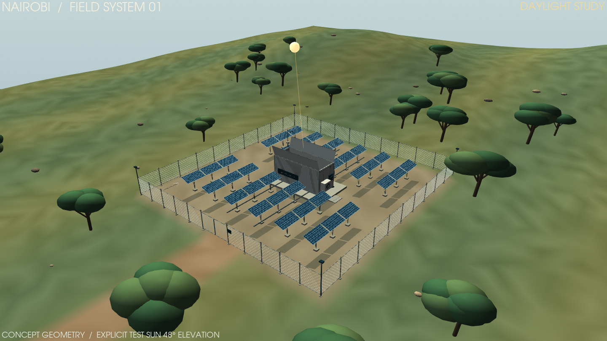
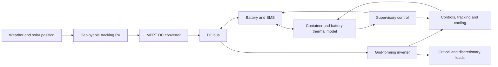

# Kenya mobile solar lab

A Python-only interactive dashboard and detailed energy/thermal/control model for deployable, container-based PV in Kenya. Nairobi is the default site. The main workspace shows a detailed 3D container compound with one-command deployment/retraction, current model weather, a clock-driven sun and analytical shadows. Historical JRC PVGIS weather remains bundled for the annual engineering studies.



## Container field lab

- **Deploy** opens the roof, lifts the panel cassettes, unfolds the arrays and engages supports. **Retract** isolates PV, packs the panels inside and closes the roof.
- Inspect the landscape, chain-link fence, gate, concrete base, all PV modules, container corrugations, battery racks, cable trays, converter cabinet, cooling grille and weather mast.
- Use the live Nairobi clock, an accelerated solar-day tour or a manual study time. Day/night lighting and shadow geometry follow the displayed sun position.
- Fetch [Open-Meteo](https://open-meteo.com/en/docs) model weather with visible timestamps and freshness. The current-weather scene requires internet access on its first use; annual cached studies work offline.
- Switch camera, cut away the enclosure, show dimensions, or enable interactive orbit inspection. Export the scene and its technical JSON snapshot.

The mechanism and landscape are engineering illustrations, not a certified machine or a surveyed site. Current weather is model output; the plant state is simulated. Packed and moving panels contribute zero accepted PV generation.


## System architecture



| Component | Location |
|---|---|
| Interactive application | `app.py` |
| PV, storage, thermal and control calculations | `solar_model/` |
| Raw weather and its provenance | `data/` |
| Detailed scene, kinematics and clock-driven plant | `solar_model/scene.py`, `mechanics.py`, `live_ui.py`, `live_simulation.py` |
| Current model weather integration | `solar_model/live_weather.py` |
| Research and engineering assumptions | `ENGINEERING_NOTES.md`, `literature.json` |
| Verification record | `VALIDATION.md` |
| Model and dashboard tests | `tests/` |
| Weather downloads, scenario validation and packaging | `tools/` |
| Automated checks on GitHub | `.github/workflows/tests.yml` |

## Run on Windows

For an existing project environment:

```powershell
.\.venv\Scripts\python.exe launch.py
```

For a fresh clone, install with Python 3.12+ (tested with 3.13):

```powershell
git clone https://github.com/BehnamMohseniGharyehsafa/kenya-mobile-solar-dashboard.git
cd kenya-mobile-solar-dashboard
python -m venv .venv
.\.venv\Scripts\python.exe -m pip install -r requirements.txt
.\.venv\Scripts\python.exe launch.py
```

Open **http://127.0.0.1:8507**. The app binds to the local computer. All application/model/chart source is Python; Streamlit and Plotly provide their normal browser runtime internally. No separate HTML/CSS/JavaScript source or cloud service is needed.

On macOS or Linux, use `python3 -m venv .venv`, activate it with `source .venv/bin/activate`, install `requirements.txt`, then run `python launch.py`. To run tests, install `requirements-dev.txt`. See [CONTRIBUTING.md](CONTRIBUTING.md) for the development workflow.

## Explore

- **Container simulator:** full 3D site, deployment/retraction, current weather, local/site clocks, moving sun, shadows, equipment details and live simulated plant state.
- **Overview:** actual modelled DC generation, useful AC renewable delivery, demand coverage, power traces, seasonal output and an energy-flow diagram.
- **Sun & tracking:** interactive 3D deployment schematic, solar path, realised panel angles, fixed/single/dual-axis comparison.
- **Storage & cooling:** SOC, battery/enclosure temperatures, cooling electricity and thermal removal, passive/ventilation/HVAC comparison.
- **Controls & faults:** state timelines, wind stow, sensor failure, tracker jam, reserve shedding, BMS trip and cooling failure.
- **Container design:** deployed footprint, equipment schedule, mass limitations and voltage/current screens.
- **Literature & model:** primary research/data sources, equation definitions and engineering limitations.
- **Data & export:** scenario CSV/JSON/ZIP, provenance, balance residuals, all parameters and custom-design import.

Change inputs in the sidebar and press **Apply design & simulate**. The top metrics cover the complete weather input; the date and time controls inspect a day without changing those totals. Synthetic demonstration weather must be explicitly selected and is clearly labelled.

The default configuration is conceptual: 19.8 kWp PV, 80 kWh LFP, 20 kW inverter, a 20 ft container, detachable tracking tables and hybrid cooling. It is not an equipment quotation or validated hardware design. Shortfalls are deliberately visible; the model does not assume guaranteed autonomy.

## Research, assumptions and verification

Read [ENGINEERING_NOTES.md](ENGINEERING_NOTES.md) for the full architecture, equations, model assumptions, controller behaviour and omitted effects. `literature.json` links each research finding to its model/design implication. Manufacturer examples are labelled separately from research and data sources.

[VALIDATION.md](VALIDATION.md) records the model/scene checks and the default whole-year results, including the visible shortfalls and model limitations.

For an existing checkout, update and reinstall dependencies before starting the new 3D workspace:

```powershell
git pull
.\.venv\Scripts\python.exe -m pip install -r requirements.txt
.\.venv\Scripts\python.exe -m streamlit run app.py --server.port 8508
```

On Linux servers, install OpenGL/EGL libraries and Xvfb for off-screen VTK rendering; the GitHub Actions workflow shows the tested setup. A desktop graphics driver is normally sufficient on Windows. All application/model/scene source remains Python; VTK and the optional inspection component supply their packaged rendering runtime.

```powershell
# Test the physical consistency and dashboard.
.\.venv\Scripts\python.exe -m pytest -q

# Recompute default results and scenario comparisons.
.\.venv\Scripts\python.exe tools/validate_model.py

# Refresh weather (requires an internet connection).
.\.venv\Scripts\python.exe tools/download_weather.py --site all
```

The user-supplied image is preserved in `assets/concept-reference.png` as concept inspiration. No equipment, structural or Kenyan climate characteristics are inferred from it.
